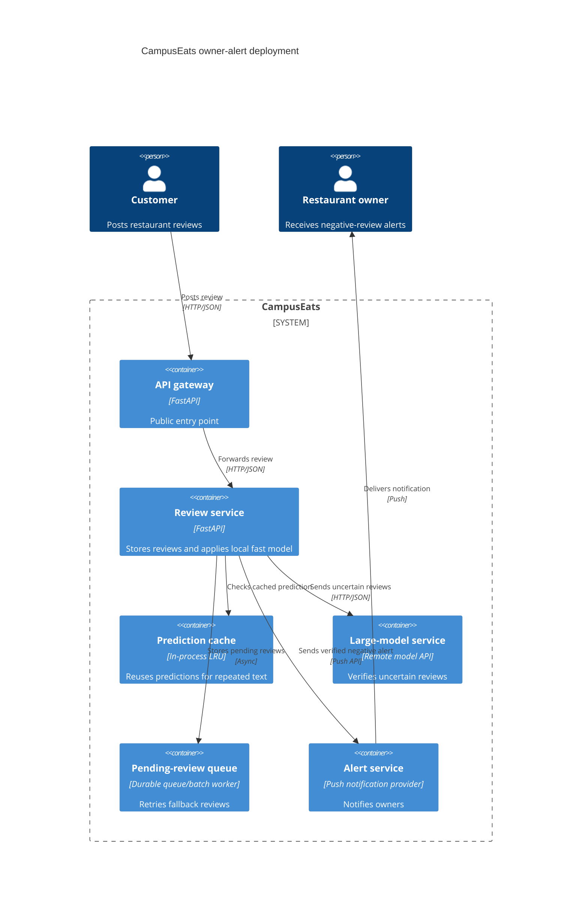

# Task 4: Deployment topologies and trade-offs

**Name:** Gianmario Carta

**Student ID:** 01224055

This is **individual work**: each student completes and submits their own copy, in their own fork.

Design a deployment for the scenario below. Use your measurements from Tasks 0–3 as evidence: cite run names from `results/runs.csv`. Answer in English.

## Scenario: Owner alerts

When a customer posts a negative review, the restaurant owner gets a push notification within **2 seconds**. At the lunch peak, CampusEats receives **40 reviews per second**. A missed alert is acceptable, but a wrong alert (for example, "your customer is unhappy" when they are happy) makes owners stop trusting alerts and, in the end, ignore them.

Facts:

- The large model serves at most **20 calls per second** (4 calls at once × about 200 ms each), and every call costs money.
- The small model is fast and cheap enough to run anywhere, including inside the review service, but it is much less accurate on its own.

## Topologies and patterns to choose from

| | Topology | Where the model runs |
|---|---|---|
| T1 | Model as a service, synchronous | Inference service, called for each review (today's baseline) |
| T2 | Model as a library | Inside the review service, or on the device |
| T3 | Hybrid | Small model locally, large model as a remote service |
| T4 | Asynchronous / batch | Reviews are queued or stored, and scored later in bulk |

Combine one topology with any of the patterns from Tasks 1–3: **fallback**, **cascade** and **cache**.

## 1. Quality requirements

The three most important quality requirements for this scenario, each with a number where possible.

| # | Quality | Requirement |
|---|---|---|
| 1 |Accuracy|At least 95% of all alerts sent must be for truly negative reviews.|
| 2 |Performance|The owner must receive the alert within 2 seconds of the review being posted, at a peak of 40 reviews/s.|
| 3 |Capacity|At a 40 reviews/s peak, at most 20 calls/s must be sent to the large model.|

## 2. Design

Your topology, the patterns you add, and a container-level diagram (C4 level 2). The C4 diagram must be written in Mermaid.

I will choose to do a Hybrid approach where the large model will only be remotely called for uncertain cases.
I will use all patters from earlier: Cascade, Cache, and Fallback. I will also add an alert gate that will only send an alert when it has sufficient confidence that it is negative.

## 3. Evidence

Which runs support your choice? Show the numbers and the capacity arithmetic: how many large-model calls per second does your design need at the peak?

| Run | What it shows |
|---|---|
|t0-large|93.5% accuracy, 513 ms p50, 661 ms p95, 100% large calls|
|t0-small|72.5% accuracy, 84 ms p50, 205 ms p95, 0% large calls|
|t2-0.7|93.0% accuracy, 572 ms p95, 53% large calls|
|t3-cache|93.0% accuracy, 521 ms p95, 38% large calls, 35% cache hits|
|t1-after|0 errors but 23 pending reviews under 10% hanging calls|

Capacity calculation for the cached hybrid design:
> 40 reviews/s × 38% large-model calls = 15.2 large calls/s
Therefore, t3-cache is below the 20 calls/second limit. By comparison:
> t2-0.7: 40 × 53% = 21.2 calls/s       exceeds capacity
> t2-0.9: 40 × 77% = 30.8 calls/s       exceeds capacity
> t0-large: 40 × 100% = 40 calls/s      exceeds capacity

## 4. ADR

An **architecture decision record (ADR)** is a short document that records one design decision: the situation that forced it (context), what you decided, and what follows from it, good and bad (consequences). Fill in the template below.

**Title:** Hybrid cascade with caching and fallback for owner alerts

**Status:** Proposed

**Context:** The large model is more accurate but supports only 20 calls/second and is slow/costly. The small model is fast but less accurate. Owner trust requires avoiding incorrect negative alerts, while notifications must arrive within 2 seconds.

**Decision:** Use T3 Hybrid. Check the cache first, use the small model locally, escalate uncertain cases to the large service, send alerts only for sufficiently trusted negative predictions, and save timeout/error cases as pending for asynchronous retry.

**Consequences:**
- Positive:
    - t3-cache suggests approximately 15.2 large calls/second at peak, below the 20-call limit.
    - Cache hits and local predictions reduce latency and cost.
    - Fallback prevents inference failures from losing reviews.
    - Conservative alerting protects owner trust by allowing missed alerts rather than uncertain alerts.
- Negative:
    - Some reviews remain pending or receive no immediate alert.
    - The large model remains a remote dependency.
    - Cache invalidation and model-version management are required.

**Alternatives considered:** at least one topology you rejected, and why.

> T4 asynchronous/batch as the primary topology because the delayed batch scoring cannot guarantee a notification withing 2 seconds.
